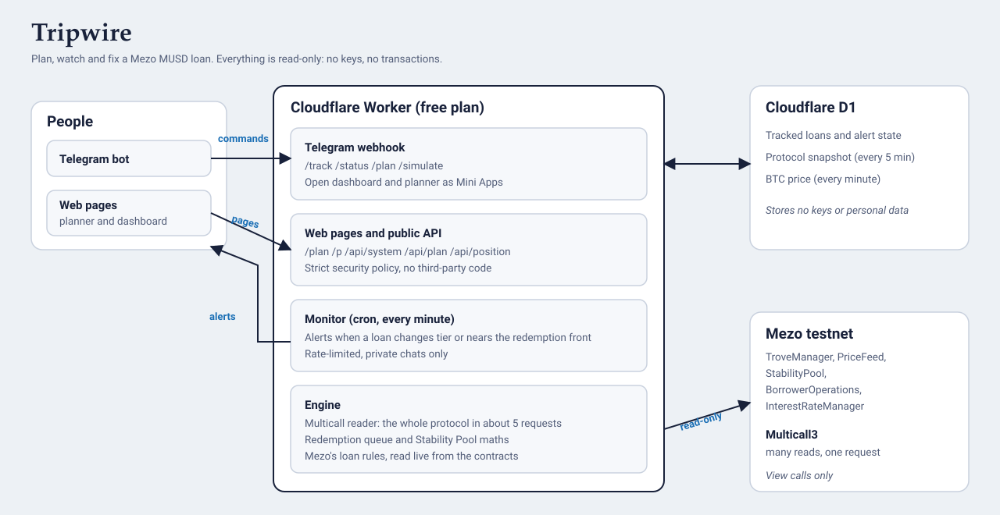

# Tripwire

**Know your liquidation line before you borrow, and get warned before you cross it.**

Tripwire is a free, read-only companion for [Mezo](https://mezo.org) MUSD loans: a **borrow planner**, a **Telegram bot**, a per-loan **dashboard** with a what-if slider, and a public **JSON API**. It covers the whole life of a loan: **plan, watch, fix**. Built for the Mezo Buildathon.

**Try it (Mezo testnet)**

| | |
|---|---|
| Telegram bot | https://t.me/creationnbot |
| Borrow planner | https://trove-guardian.gavriil.workers.dev/plan |
| Check a loan | https://trove-guardian.gavriil.workers.dev/p |
| Live API | https://trove-guardian.gavriil.workers.dev/api/system |



## The problem

Borrowing MUSD against Bitcoin is simple until the price moves. A loan below 110% collateral can be liquidated, and the lowest-ratio loans are first in line to be redeemed. Most tools watch a loan you already have. Few help you choose how much to borrow in the first place, and none of that explains the risk in plain words to someone new.

## What Tripwire does

**Plan.** Enter the BTC you would deposit and drag a caution slider. The planner shows what you would actually receive, the fee, total debt, liquidation price, how far BTC can fall, a year of interest, your place in today's redemption queue, and an estimated chance of liquidation. A table compares six caution levels side by side. When a choice would be refused, it says why in plain words and how much BTC would fix it.

**Watch.** Send `/track <wallet address>` to the bot. It checks every minute and messages you when a loan moves into a riskier tier (watch, warning, urgent, liquidatable), when it recovers, or when it is among the first in the redemption queue. A 3-point buffer stops repeat messages when a ratio hovers near a line.

**Fix.** `/simulate 30` (or the dashboard slider) shows what a 30% BTC fall does to your ratio and tier, and exactly how much collateral to add, or MUSD to repay, to get back to 135%, 150% or 200%. Every action is a link to Mezo's own app. Tripwire never touches your funds.

Bot commands: `/track`, `/status`, `/plan`, `/simulate`, `/alerts`, `/list`, `/untrack`, `/help`. Replies carry an **Open dashboard** button that opens the web pages inside Telegram as a Mini App.

## How it uses Mezo

Everything comes from Mezo's contracts on testnet, with nothing hard-coded that the chain can tell us:

- `TroveManager`: `getTroveOwnersCount`, `getTroveFromTroveOwnersArray`, `getEntireDebtAndColl`
- `PriceFeed`: `fetchPrice`
- `StabilityPool`: `getTotalMUSDDeposits`
- `BorrowerOperations`: `minNetDebt`, `borrowingRate`
- `InterestRateManager`: `interestRate`
- **Multicall3**: the whole protocol (price, pool, loan terms and every trove) is read in about **5 requests**, so the hosted bot stays inside Cloudflare's free plan however many people use it.

The rules are mirrored from the Mezo source, not guessed:

- **Redemption queue** follows `TroveManager.redeemCollateral`: lowest collateral ratio first, loans already under 110% skipped, and debt redeemed net of the 200 MUSD gas deposit. The planner and dashboard show how much MUSD must be redeemed before yours.
- **Loan rules** follow `BorrowerOperations.openTrove`: the fee is charged on the amount borrowed (waived in Recovery Mode), the 200 MUSD gas deposit is added to the debt, the minimum loan applies to amount plus fee, the ratio must clear 110% (150% in Recovery Mode), and a new loan cannot push the whole system below 150%.
- **Recovery Mode** does not change the liquidation line (per Mezo's docs); it only blocks new loans below 150%.

### How the numbers are produced

1. Every 5 minutes: a full read of every trove, saved in Cloudflare D1.
2. Every minute: one small request refreshes the price and the tracked loans on top of that snapshot.
3. The redemption queue, each loan's place in it, the system ratio and the liquidation wall are worked out in memory, so cost does not grow with the number of users.

The Multicall encoder and decoder are hand-written, because the general-purpose one cost about 11 ms of CPU for a full read (the free plan allows 10 ms per run). The hand-written version is tested against viem on 120 random inputs and measured at 3 to 5 ms in Node.

### The estimate of liquidation chance

The planner's "chance of liquidation" is a deliberately simple, openly stated model: BTC moves randomly with a yearly volatility you pick (calm 40%, typical 60%, wild 90%) and no trend, and the chance is that it touches your liquidation price at least once in the window: `2 x N(-ln(ratio / 1.1) / (sigma x sqrt(T)))`, the reflection principle. It ignores sudden jumps, so it understates real crash risk. The page says so. It is a guide for comparing choices, not a promise.

## Public API

- `GET /api/system`: BTC price, system ratio, Stability Pool, loans grouped by ratio, the **liquidation wall** (debt exposed if BTC falls 5% to 60%, and whether the Stability Pool could absorb it) and the first 20 in the redemption queue.
- `GET /api/plan`: Mezo's live loan terms, the system totals, and every redeemable loan as `[ratio %, MUSD redemptions can take]`.
- `GET /api/position?address=0x...`: one position with its liquidation price and queue place.
- `GET /api/prices?hours=24`: one BTC price per minute from Mezo's own oracle.

## Security and privacy

- **Read-only.** Only view functions are called. No keys, no seed phrases, no transactions.
- **Webhook authentication.** Telegram's secret header is compared in constant time; forged requests get a 401 before any work is done.
- **Secrets** live only in Cloudflare secrets and a git-ignored `.env`. `wrangler.toml` holds none.
- **Abuse limits.** Private chats only, 12 messages per chat per minute, 5 tracked addresses per chat, 100 in total, 30 API calls per minute per client. Users who block the bot are removed automatically.
- **Web pages** run under a strict Content-Security-Policy: no inline scripts, no third-party code, no `eval`; API values are written into pages as text only. Framing is allowed only from Telegram's own web clients so the Mini App works.
- **Data stored:** Telegram chat ID, the public address tracked, and the last alert state. `/untrack` deletes it.
- `npm audit --omit=dev` reports 0 vulnerabilities.

## Testing, and what is not claimed

171 unit tests cover: the risk and queue maths; the Multicall codec against viem on random inputs; a simulated chain for the whole engine; the real D1 SQL on SQLite; the alert state machine; the bot's command handlers with Telegram faked; the pages and the browser scripts (the shipped files are run in Node and checked against hand-worked numbers); and config validation. The pages were also exercised in headless Chromium with the strict security headers, and the Worker in Cloudflare's local runtime. On testnet, `npm run system` and `npm run check` print this engine's numbers next to the contracts' own so any decoding problem shows up immediately.

Honest limits:

- Mezo **testnet** only. Mainnet needs its own addresses and a fresh verification.
- Alert thresholds (watch below 150%, warning below 135%, urgent below 120%) are design defaults, not protocol values.
- The liquidation-chance model is simple (see above).
- Production CPU on Cloudflare's free plan is designed for and benchmarked in Node, not formally measured live.
- Tripwire reads and advises. It does not execute transactions, by design.

## Run it yourself

```bash
npm install
npm test                                      # 171 tests, no network needed
npm run check -- 0xYourWalletAddress          # one loan, cross-checked against the contracts
npm run system                                # the whole protocol, cross-checked against the contracts
```

Local bot (needs a token from @BotFather):

```bash
cp .env.example .env          # then paste the token after TELEGRAM_BOT_TOKEN=
npm run bot
```

Hosted (Cloudflare Workers free plan):

```bash
npx wrangler login
npx wrangler d1 create trove-guardian          # paste the database_id into wrangler.toml
npx wrangler d1 migrations apply trove-guardian --remote
npx wrangler deploy
npx wrangler secret put TELEGRAM_BOT_TOKEN
npx wrangler secret put WEBHOOK_SECRET
npm run set-webhook -- https://your-worker.your-name.workers.dev
```

Set `BOT_USERNAME`, `REPO_URL` and `SITE_URL` in `wrangler.toml` to link the pages and enable the Mini App buttons. `DEMO_PRICE_DROP_PCT` pretends BTC is lower so alerts can be shown on a healthy loan (every message is labelled DEMO MODE); leave it blank normally.

## Roadmap

- An optional, non-custodial **rescue**: pre-approved top-ups that only the owner can authorise.
- More languages (French, Spanish, Portuguese first), reviewed by native speakers because these are safety messages.
- Mainnet support.

## License

MIT
